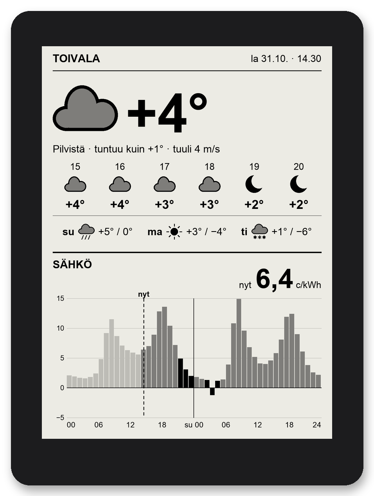
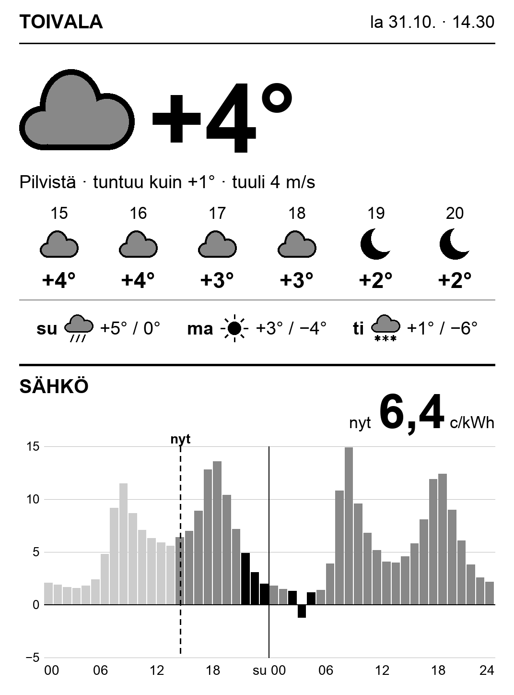
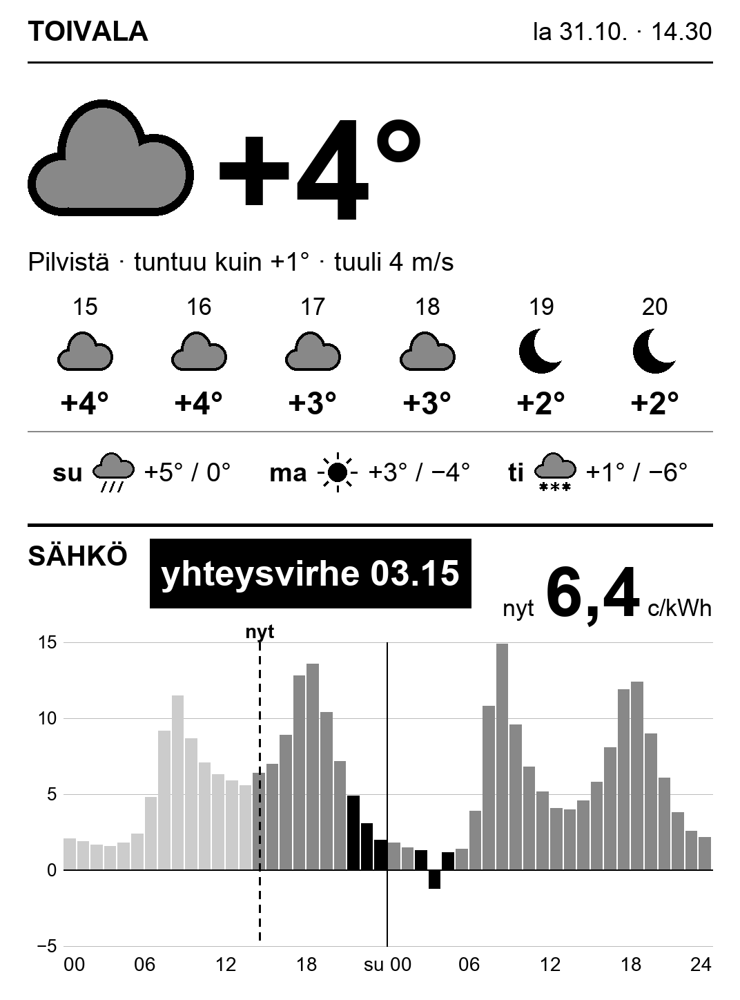
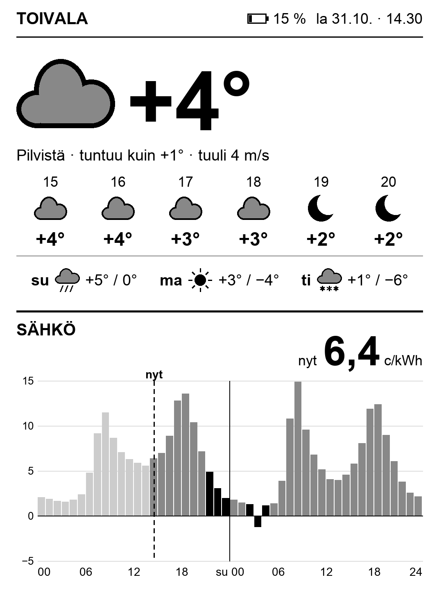

# kindle-dashboard-fi

🇬🇧 [In English](README.md)


**Laatikossa lojuva Kindle seinälle tai pöydälle näyttämään sään ja pörssisähkön hinnan.**
Näytöltä näkee yhdellä silmäyksellä, onko ulkona pakkasta ja mihin kellonaikaan pyykinpesu, saunan lämmitys tai auton lataus kannattaa ajoittaa.

<p align="center">
  
</p>

## Mitä näytöllä on

- **Sää nyt:** lämpötila isolla, sääsymboli, tuntuu kuin -lämpötila ja tuuli.
- **Seuraavat 6 tuntia** ja **kolmen päivän ennuste** (ylin ja alin lämpötila).
- **Sähkön pörssihinta tänään ja huomenna** tunneittain (c/kWh, sis. ALV 25,5 %):
  - "nyt"-viiva ja tämän hetken hinta isolla
  - päivän **3 halvinta tuntia mustalla**. Tänään halvimmat valitaan vain jäljellä olevista tunneista, eli mennyttä halpaa tuntia ei enää tarjota.
  - menneet tunnit vaaleina, negatiiviset hinnat nollaviivan alla
  - huomisen hinnat ilmestyvät, kun ne julkaistaan (noin klo 14). Sitä ennen näytöllä lukee "huomisen hinnat n. klo 14".
- **Varoitukset:** vanhentuneet tiedot ("hinnat päivitetty 31.10. 14.05"), akku vähissä ja yhteysvirhe.

| Tavallinen näkymä | Yhteysvirhe | Akku vähissä |
| --- | --- | --- |
|  |  |  |

## Miten se toimii

```
Ilmatieteen laitos (sää)  ─┐
                           ├─> Mac (Python, piirtää PNG:n) ── kotiverkko, HTTP ──> Kindle (curl + eips)
porssisahko.net (hinnat)  ─┘
```

- **Mac** hakee sään ja hinnat, piirtää niistä 1072×1448-kokoisen harmaasävykuvan ja jakaa sen kotiverkkoon (portti 8088). Sää haetaan puolen tunnin välein. Hinnat haetaan 6 tunnin välein ja iltapäivällä vartin välein, kunnes huomisen hinnat ovat saatavilla.
- **Kindle** ajaa pientä shell-skriptiä: Wi-Fi päälle, kuva Macilta, kuva näytölle, Wi-Fi pois ja uni. Päivällä (06–23) tämä toistuu 30 minuutin välein ja yöllä 2 tunnin välein, ja aamulla kuva päivittyy viimeistään klo 6.
- Kindlellä ei ajeta Pythonia eikä mitään raskasta, ja kaikki logiikka on Macilla. Siksi ulkoasua voi muuttaa ja testata koskematta Kindleen.

## Mitä tarvitaan

| | |
| --- | --- |
| **Kindle** | Jailbreakattu Kindle, joka osaa ajaa *scriptlettejä* (`.sh`-tiedostoja kirjastossa). Testattu: **Kindle Paperwhite 3 (7. sukupolvi), firmware 5.16.2.1.1, WinterBreak-jailbreak**. Muut 1072×1448-näytölliset mallit (esim. PW4, Voyage) toimivat todennäköisesti, mutta niitä ei ole testattu. Jailbreak-ohjeet: [kindlemodding.org](https://kindlemodding.org/). |
| **Palvelin** | Aina päällä oleva **Mac** (esim. Mac mini) samassa kotiverkossa. Kuvat piirretään macOS:n Arial-fontilla, joten palvelin vaatii tällä hetkellä macOS:n. |
| **Ohjelmat** | [uv](https://docs.astral.sh/uv/) (asentaa Python 3.12:n ja Pillow'n). |
| **Sijainti** | Suomi: sää tulee Ilmatieteen laitokselta ja hinnat Suomen hinta-alueelta. Näytön tekstit ovat suomeksi. |

## Alkuun pääseminen

**1. Mac: asenna ja kokeile**

```sh
git clone https://github.com/trotor/kindle-dashboard-fi.git
cd kindle-dashboard-fi
cp config.example.toml config.toml        # vaihda paikka ja koordinaatit
uv run python -m saasahko preview out.png --config config.toml
open out.png
```

**2. Mac: käynnistä palvelu taustalle** (käynnistyy kirjautuessa ja pysyy päällä)

```sh
scripts/install-mac-service.sh
curl http://localhost:8088/health
```

Jos macOS kysyy, saako Python ottaa vastaan yhteyksiä, vastaa *Salli*.
Vinkki: tee Macille reitittimessä DHCP-varaus, jotta sen osoite ei vaihdu.

**3. Kindle: kopioi tiedostot**

Liitä jailbreakattu Kindle USB:llä ja aja:

```sh
scripts/deploy-kindle.sh
```

Skripti kopioi näyttöohjelman ja kirjoittaa Kindlelle asetustiedoston `saa-ja-sahko.conf`, johon tulee Macin IP-osoite. Irrota Kindle.

**4. Kindle: käynnistä**

Napauta Kindlen kirjastossa **"Sää ja sähkö"**. Kindlen oma käyttöliittymä sulkeutuu, ja kuva tulee näytölle noin puolessa minuutissa.

**Takaisin lukemiseen:** pidä virtanappia pohjassa 20–40 sekuntia, jolloin Kindle käynnistyy uudelleen tavallisena Kindlenä. Näyttötila ei käynnisty itsestään, vaan napauta "Sää ja sähkö" uudelleen.

## Asetukset

**Mac: `config.toml`**

| Asetus | Merkitys |
| --- | --- |
| `place_name`, `lat`, `lon` | Paikan nimi otsikossa ja koordinaatit sääennusteelle |
| `margin_c` | Sähkönmyyjän marginaali, c/kWh (lisätään näytettyyn hintaan) |
| `transfer_c` | Siirtomaksu, c/kWh (lisätään näytettyyn hintaan) |
| `low_battery_percent` | Akkuvaroituksen raja (oletus 20) |
| `port` | Palvelimen portti (oletus 8088) |
| `cache_dir`, `timezone` | Välimuistin kansio ja aikavyöhyke |

Muutoksen jälkeen: `launchctl kickstart -k gui/$(id -u)/fi.ronkko.saasahko`

**Kindle: `saa-ja-sahko.conf`** (USB-levyn juuressa)

| Asetus | Merkitys |
| --- | --- |
| `URL` | Kuvan osoite Macilla, esim. `http://192.168.1.10:8088/kindle.png` |
| `FRONTLIGHT` | Etuvalon kirkkaus (0 = pois) |
| `WIFI_OFF_BETWEEN` | 1 = Wi-Fi pois hakujen välillä (oletus). 0 = Wi-Fi aina päällä, tarvitaan vain vianetsinnässä. |

## Hyvä tietää

- **Akku:** Kindle pysyy hereillä, joten akku kestää noin vuorokaudesta muutamaan päivään. Pidä Kindle laturissa. Kun varaus laskee alle varoitusrajan, kuvaan tulee varoitus.
- **Wi-Fi:** monet tukiasemat pudottavat käyttämättömän laitteen verkosta. Siksi Wi-Fi on oletuksena pois päältä hakujen välillä. Jos yhteys ei silti palaa, näyttöohjelma sammuttaa ja käynnistää radion ja tarvittaessa Kindlen Wi-Fi-palvelun. Kaikki kirjautuu lokiin `saa-ja-sahko.log`.
- **Yhteysvirhe:** jos Mac ei vastaa, vanha kuva jää näkyviin, ja sähkökuvaajan yläpuolelle tulee isolla "yhteysvirhe HH.MM".
- **FileVault:** jos Macissa on FileVault päällä, palvelu käynnistyy Macin uudelleenkäynnistyksen jälkeen vasta, kun kirjaudut sisään.
- **Amazonin päivitykset:** ohjelmistopäivitys voi poistaa jailbreakin. Näyttöohjelma pysäyttää päivityspalvelut joka kierroksella ja poistaa ladatut päivitystiedostot.
- **Älä aja Kindlellä `stop lab126_gui`:** se kaataa koko käyttöliittymäsession, ja Kindle pitää käynnistää uudelleen. Näyttöohjelma sulkee käyttöliittymän turvallisesti komennoilla `stop framework` ja `stop pillow`.

## Vianetsintä

```sh
curl http://localhost:8088/health        # Macin palvelun tila ja viimeisimmät haut
tail -f ~/Library/Logs/saasahko.log      # Macin loki (jokainen Kindlen haku näkyy)
```

Kindlen loki on tiedostossa `saa-ja-sahko.log` USB-levyn juuressa: `fetch ok batt=NN` tai `fetch failed rc=NN`, ja Wi-Fin palautukset riveillä `wifi ... ->`.

**Kehitysyhteys** (telnet, vain vianetsintään):

1. Aja `scripts/deploy-kindle.sh --dev` ja aseta Kindlen asetuksiin `WIFI_OFF_BETWEEN=0`.
2. Napauta kirjastossa "Kehitysyhteys". Näytölle tulee Kindlen IP-osoite.
3. Aja Macilla: `KINDLE_IP=<ip> scripts/kindle-sh "tail -20 /mnt/us/saa-ja-sahko.log"`.

Yhteys on **salaamaton root-yhteys**, ja se on rajattu vain Macin osoitteeseen. Se sulkeutuu, kun Kindle käynnistetään uudelleen. Kun et enää tarvitse yhteyttä, aja `scripts/deploy-kindle.sh` ilman `--dev`-valitsinta, niin skriptikin poistuu Kindleltä.

## Kehitys

```sh
uv run pytest                            # 177 testiä
uv run python scripts/make_screenshots.py  # README:n kuvat esimerkkidatasta
```

| Kansio | Sisältö |
| --- | --- |
| `saasahko/` | Mac-palvelu: tietojen haku, välimuisti, näytön tila, piirto ja HTTP |
| `kindle/` | Kindlen skriptit: näyttöohjelma (`saa-ja-sahko/`) ja kirjaston scriptletit (`documents/`) |
| `scripts/` | Asennus Macille ja Kindlelle, telnet-apuri, kuvakaappaukset |
| `docs/superpowers/` | Alkuperäinen suunnitelma ja toteutussuunnitelma (suomeksi) |

## Tietolähteet ja lisenssi

- Sää: **Ilmatieteen laitos**, avoin data ([CC BY 4.0](https://creativecommons.org/licenses/by/4.0/)).
- Sähkön hinnat: [porssisahko.net](https://porssisahko.net/). Hinnat ovat Nord Poolin vuorokausimarkkinan Suomen aluehinnat, ja ne sisältävät ALV:n.
- Koodi: [MIT](LICENSE). Projekti ei liity Amazoniin. Jailbreakin käyttö on omalla vastuullasi.
