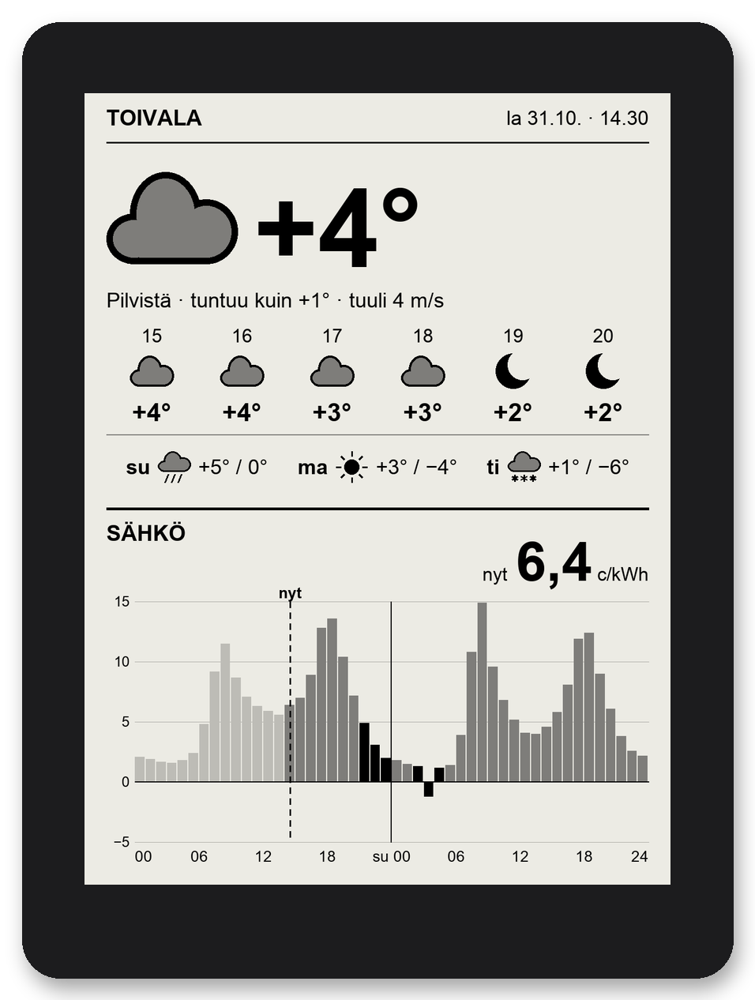
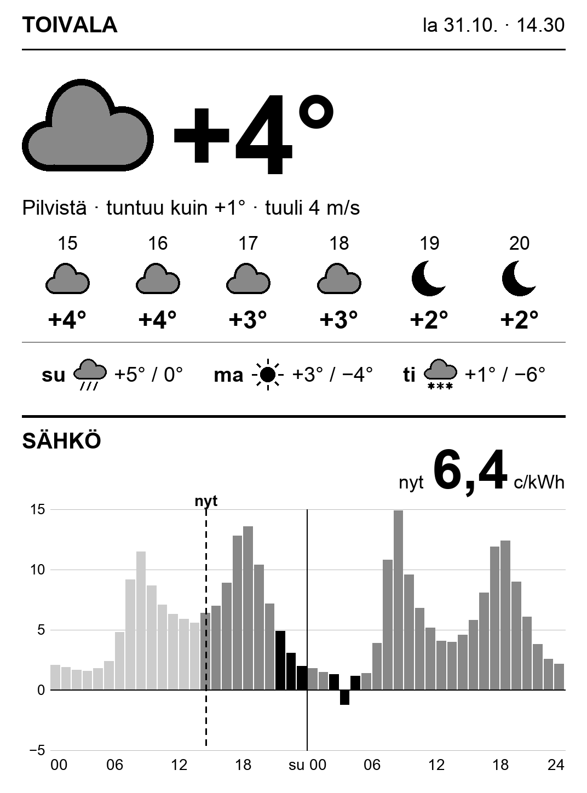
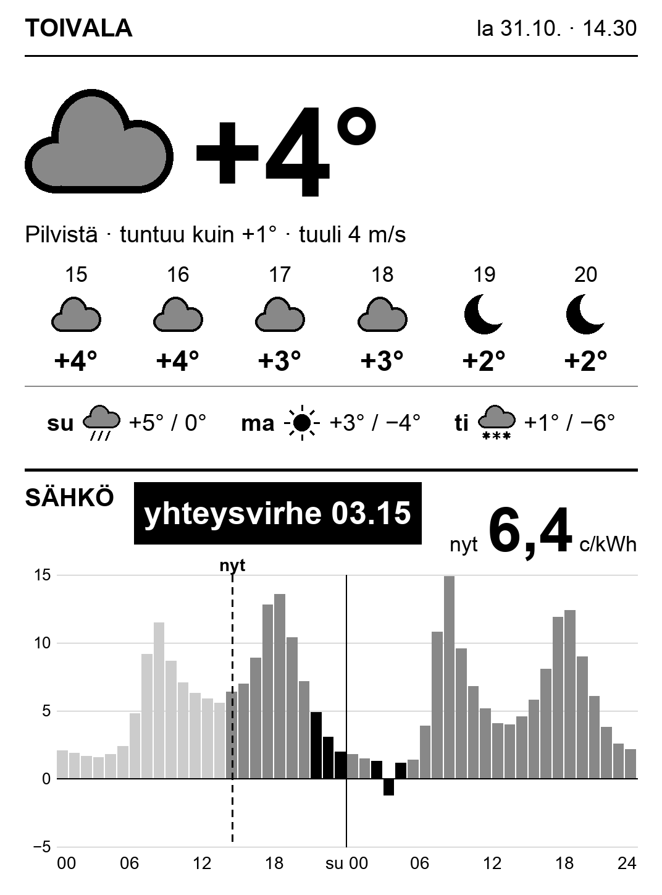
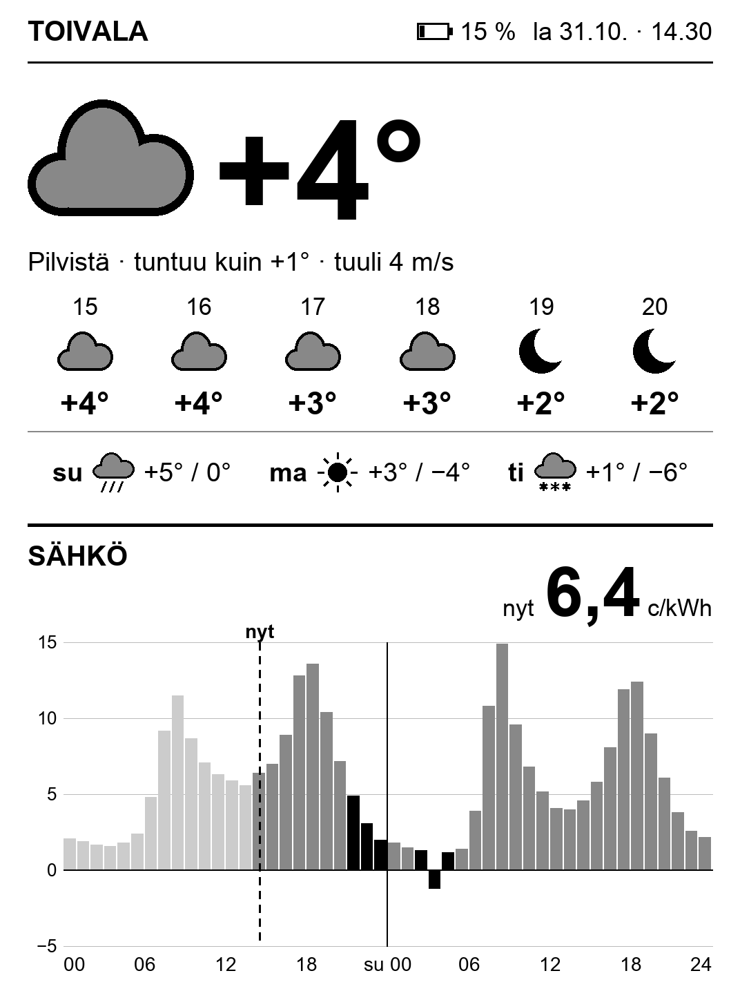

# kindle-dashboard-fi

🇫🇮 [Suomeksi](README.fi.md)


**Put the old Kindle from your drawer on the wall or a shelf and let it show the weather and Finnish spot electricity prices.**
One glance tells you how cold it is outside and when to run the washing machine, heat the sauna or charge the car.

<p align="center">
  
</p>

## What it shows

- **Current weather:** a big temperature, a weather symbol, feels-like temperature and wind.
- **The next 6 hours** and a **3-day forecast** (high and low).
- **Spot electricity price today and tomorrow**, hour by hour (c/kWh, Finnish VAT 25.5 % included):
  - a "now" line and the current price in large type
  - each day's **3 cheapest hours in black**. For today they are picked from the hours that are still ahead, so a cheap hour that has already passed is never suggested.
  - past hours in light grey, negative prices below the zero line
  - tomorrow's prices appear once they are published (around 14:00 Finnish time). Before that the chart says "huomisen hinnat n. klo 14" ("tomorrow's prices around 14:00").
- **Warnings:** stale data, low battery and connection errors.

The on-screen text is in Finnish.

| Normal | Connection error | Low battery |
| --- | --- | --- |
|  |  |  |

## How it works

```
Finnish Meteorological Institute (weather) ─┐
                                            ├─> Mac (Python renders a PNG) ── home LAN, HTTP ──> Kindle (curl + eips)
porssisahko.net (spot prices)              ─┘
```

- **The Mac** fetches the weather and prices, renders one 1072×1448 greyscale image and serves it on your home network (port 8088). Weather is fetched every 30 minutes. Prices are fetched every 6 hours, and every 15 minutes in the afternoon until tomorrow's prices are out.
- **The Kindle** runs a small shell loop: Wi-Fi on, fetch the image, draw it, Wi-Fi off, sleep. It repeats every 30 minutes during the day (06–23) and every 2 hours at night, with a guaranteed refresh at 06:00.
- The Kindle runs no Python and nothing heavy; all logic lives on the Mac. You can change and test the layout without touching the Kindle.

## Requirements

| | |
| --- | --- |
| **Kindle** | A jailbroken Kindle that can run *scriptlets* (`.sh` files shown in the library). Tested on a **Kindle Paperwhite 3 (7th gen), firmware 5.16.2.1.1, WinterBreak jailbreak**. Other models with a 1072×1448 screen (PW4, Voyage) will probably work but are untested. Jailbreak guides: [kindlemodding.org](https://kindlemodding.org/). |
| **Server** | An always-on **Mac** (e.g. a Mac mini) on the same network. The renderer uses macOS's Arial font, so the server currently needs macOS. |
| **Software** | [uv](https://docs.astral.sh/uv/) (installs Python 3.12 and Pillow for you). |
| **Location** | Finland: the forecast comes from the Finnish Meteorological Institute and the prices are for the Finnish bidding zone. |

## Getting started

**1. Mac: install and try it**

```sh
git clone https://github.com/trotor/kindle-dashboard-fi.git
cd kindle-dashboard-fi
cp config.example.toml config.toml        # set your place and coordinates
uv run python -m saasahko preview out.png --config config.toml
open out.png
```

**2. Mac: run it as a background service** (starts at login, restarts if it crashes)

```sh
scripts/install-mac-service.sh
curl http://localhost:8088/health
```

If macOS asks whether Python may accept incoming connections, choose *Allow*.
Tip: give the Mac a DHCP reservation in your router so its address doesn't change.

**3. Kindle: copy the files**

Connect the jailbroken Kindle over USB and run:

```sh
scripts/deploy-kindle.sh
```

This copies the display loop to the Kindle and writes its settings file `saa-ja-sahko.conf` with your Mac's IP address. Eject the Kindle.

**4. Kindle: start it**

Tap **"Sää ja sähkö"** in the Kindle library. The normal Kindle UI closes and the dashboard appears in about half a minute.

**Back to reading:** hold the power button for 20–40 seconds. The Kindle restarts as a normal Kindle. The dashboard does not start by itself; tap "Sää ja sähkö" again when you want it back.

## Configuration

**Mac: `config.toml`**

| Setting | Meaning |
| --- | --- |
| `place_name`, `lat`, `lon` | Name shown in the header and the coordinates for the forecast |
| `margin_c` | Your retailer's margin, c/kWh (added to the displayed price) |
| `transfer_c` | Grid transfer fee, c/kWh (added to the displayed price) |
| `low_battery_percent` | Low-battery warning threshold (default 20) |
| `port` | Server port (default 8088) |
| `cache_dir`, `timezone` | Cache directory and time zone |

After a change: `launchctl kickstart -k gui/$(id -u)/fi.ronkko.saasahko`

**Kindle: `saa-ja-sahko.conf`** (in the root of the USB drive)

| Setting | Meaning |
| --- | --- |
| `URL` | Image address on the Mac, e.g. `http://192.168.1.10:8088/kindle.png` |
| `FRONTLIGHT` | Front light brightness (0 = off) |
| `WIFI_OFF_BETWEEN` | 1 = Wi-Fi off between fetches (default). 0 = Wi-Fi always on, needed only for troubleshooting. |

## Good to know

- **Battery:** the Kindle stays awake, so a charge lasts from about a day to a few days. Keep it on a charger. The dashboard warns when the battery drops below the threshold.
- **Wi-Fi:** many access points drop idle clients, which is why Wi-Fi is off between fetches by default. If the connection still doesn't come back, the loop toggles the radio and, if needed, restarts the Kindle's Wi-Fi daemon. Everything is logged to `saa-ja-sahko.log`.
- **Connection error:** if the Mac doesn't answer, the old image stays on screen and "yhteysvirhe HH.MM" ("connection error") appears in large type above the price chart.
- **FileVault:** if FileVault is on, after the Mac reboots the service starts only once you log in.
- **Amazon updates:** an over-the-air update can remove the jailbreak. The loop stops the update services on every cycle and deletes downloaded update files.
- **Never run `stop lab126_gui` on the Kindle:** it kills the whole UI session and the Kindle has to be restarted. The loop closes the UI safely with `stop framework` and `stop pillow`.

## Troubleshooting

```sh
curl http://localhost:8088/health        # service status and last fetch times
tail -f ~/Library/Logs/saasahko.log      # service log (every Kindle fetch shows up)
```

The Kindle log is `saa-ja-sahko.log` in the root of the USB drive. It has lines like `fetch ok batt=NN` or `fetch failed rc=NN`, and Wi-Fi recoveries as `wifi ... ->` lines.

**Dev access** (telnet, for troubleshooting only):

1. Run `scripts/deploy-kindle.sh --dev` and set `WIFI_OFF_BETWEEN=0` in the Kindle settings.
2. Tap "Kehitysyhteys" in the library. The Kindle shows its IP address.
3. On the Mac, run `KINDLE_IP=<ip> scripts/kindle-sh "tail -20 /mnt/us/saa-ja-sahko.log"`.

This is an **unencrypted root shell**, restricted to the Mac's address. It closes when the Kindle restarts. When you no longer need it, run `scripts/deploy-kindle.sh` without `--dev`, which also removes the scriptlet from the Kindle.

## Development

```sh
uv run pytest                              # 177 tests
uv run python scripts/make_screenshots.py  # README images from sample data
```

| Folder | Contents |
| --- | --- |
| `saasahko/` | Mac service: fetching, cache, dashboard state, rendering, HTTP |
| `kindle/` | Kindle side: the display loop (`saa-ja-sahko/`) and library scriptlets (`documents/`) |
| `scripts/` | Mac and Kindle installers, telnet helper, screenshots |
| `docs/superpowers/` | Original design and implementation plan (in Finnish) |

## Data sources and license

- Weather: **Finnish Meteorological Institute** open data ([CC BY 4.0](https://creativecommons.org/licenses/by/4.0/)).
- Electricity prices: [porssisahko.net](https://porssisahko.net/). These are Nord Pool day-ahead prices for the Finnish bidding zone, VAT included.
- Code: [MIT](LICENSE). This project is not affiliated with Amazon. Jailbreaking is at your own risk.
